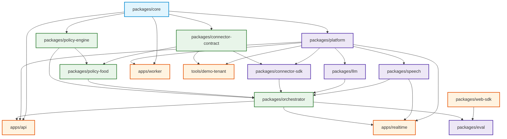

# Implementation Plan (PLAN.md)

This document defines the module-by-module implementation architecture, explicit package dependencies, file manifests, and strict build order for the generic, multi-tenant Voice Commerce Assistant SaaS platform.

---

## 1. Monorepo Structure & Package Manifest

The repository uses `pnpm` workspaces with strict boundary linting (no cross-package circular dependencies; apps depend on packages, but packages never depend on apps).

```text
voice-commerce-assistant/
├── apps/
│   ├── api/                       # Fastify REST Gateway (Sessions, Turns, Proposals, Admin)
│   ├── realtime/                  # WebSocket Streaming Voice Gateway (Binary frames, Audio)
│   └── worker/                    # Background Tasks (Retention, Metering Rollup, Outbox)
├── packages/
│   ├── core/                      # Pure Domain Types, Errors, Tenancy Context, Result monad
│   ├── platform/                  # Logging, Tracing, Crypto/KMS, Rate Limiting, Idempotency, DB/RLS
│   ├── connector-contract/        # OpenAPI 3.1 & TypeBox schemas for Tenant Connector API
│   ├── connector-sdk/             # Signed HTTPS client with SSRF Guard, DNS Pinning, Circuit Breaker
│   ├── policy-engine/             # Generic Tri-State Logic, Constraint Rules, Proposal Lifecycle
│   ├── policy-food/               # Food Pack: Jain, GF, Allergens, Protein, Group Budget Solver
│   ├── llm/                       # Provider Registry, OpenAI Adapter, Router, Rate Governor, Repair
│   ├── speech/                    # Streaming STT/TTS Interfaces, Hosted Adapters, Audio Chunking
│   ├── orchestrator/              # Conversation State Machine, Fast Paths, Grounding Guard, Normalizer
│   ├── web-sdk/                   # Headless Client SDK + React UI Component (AudioWorklet PCM)
│   └── eval/                      # Multilingual Test Harness (150 Utterances), Bake-Off, k6 Load Tests
├── tools/
│   └── demo-tenant/               # "ARPZO" Demo Tenant Backend with Seeded Branch Menus & Checkout
├── docs/                          # Architecture, Specs, Threat Model, ADRs, Runbooks
├── docker-compose.yml             # Postgres, Redis, PgBouncer, Apps & Demo Tenant
├── pnpm-workspace.yaml            # Monorepo Workspace Definitions
├── tsconfig.base.json             # Root TypeScript Configuration (Strict, ES2022)
└── package.json                   # Root Package Manifest & Scripts
```

---

## 2. Package Dependency Graph & Build Order



---

## 3. Module-by-Module Plan & Detailed File Manifests

### Module 0: Repository Foundation & Tooling (Phase 0)
- **Goal:** Establish strict monorepo layout, deterministic package builds, typecheck, linting, git hooks, CI pipelines, and local container infrastructure.
- **Files:**
  - `pnpm-workspace.yaml`, `package.json`, `.npmrc`
  - `tsconfig.base.json`, `.editorconfig`, `.gitignore`
  - `.eslintrc.js`, `.prettierrc.json`
  - `.github/workflows/ci.yml` (Lint, Typecheck, Test, Dependency Audit, Secret Scan)
  - `docker-compose.yml` (PostgreSQL 16, Redis 7, PgBouncer, mock services)
  - `.env.example` (All environment variables with documentation and secure defaults)
  - `docs/THREAT_MODEL.md` (STRIDE analysis across all boundaries)
  - `docs/SECURITY.md` (Vulnerability disclosure, security policy, ASVS L2 checklist)

### Module 1: Platform Core and Tenancy Engine (Phase 1)
- **Goal:** Provide bulletproof multi-tenant isolation, database connections with RLS, config validation, cryptographic envelope encryption, rate limiting, and structured logging.
- **Packages:** `packages/core`, `packages/platform`
- **Files:**
  - `packages/core/src/types/id.ts` (Branded types: `TenantId`, `SessionId`, `UserId`, `ProposalId`)
  - `packages/core/src/types/currency.ts` (ISO 4217 `CurrencyAmount` with minor units)
  - `packages/core/src/errors/app-error.ts` (Structured errors: `UnauthorizedError`, `ConflictError`, etc.)
  - `packages/core/src/result/result.ts` (`Result<T, E>` monad for deterministic error handling)
  - `packages/core/src/context/tenant-context.ts` (AsyncLocalStorage tenant context carrier)
  - `packages/platform/src/config/schema.ts` (TypeBox/Zod schema for all system variables)
  - `packages/platform/src/logging/logger.ts` (Pino async redacting logger with PII scrubbing)
  - `packages/platform/src/crypto/kms-adapter.ts` (Envelope encryption interface)
  - `packages/platform/src/crypto/local-dev-kms.ts` (AES-256-GCM dev implementation)
  - `packages/platform/src/database/postgres-pool.ts` (Connection pool with RLS context injector)
  - `packages/platform/src/database/migrations/` (Initial migrations: tenants, api_keys, preferences, audit)
  - `packages/platform/src/redis/redis-client.ts` (Namespaced Redis client with cluster support)
  - `packages/platform/src/concurrency/rate-limiter.ts` (Distributed sliding window rate limiter)
  - `packages/platform/src/concurrency/single-flight.ts` (Single-flight coalescing for duplicate calls)
  - `packages/platform/src/concurrency/circuit-breaker.ts` (Three-state circuit breaker)
  - `packages/platform/src/idempotency/idempotency-store.ts` (Atomic Redis/Postgres idempotency engine)

### Module 2: Connector Framework & Demo Tenant (Phase 2)
- **Goal:** Enable any platform to plug in via a signed HTTPS contract. Build client SDK with SSRF defense and seedable demo tenant.
- **Packages:** `packages/connector-contract`, `packages/connector-sdk`, `tools/demo-tenant`
- **Files:**
  - `packages/connector-contract/src/openapi.yaml` (Official OpenAPI 3.1 specification)
  - `packages/connector-contract/src/schemas/catalog.ts` (Menu items, variants, options, facts)
  - `packages/connector-contract/src/schemas/cart.ts` (Proposal validation, pricing, commit)
  - `packages/connector-contract/src/schemas/orders.ts` (Order history, live tracking, status)
  - `packages/connector-contract/src/schemas/events.ts` (Signed webhooks for stock/menu invalidation)
  - `packages/connector-sdk/src/client.ts` (Signed HTTPS client with keep-alive pooling)
  - `packages/connector-sdk/src/ssrf-guard.ts` (DNS resolver with RFC1918/link-local/metadata IP pinning)
  - `packages/connector-sdk/src/signer.ts` (HMAC-SHA256 signature generation and verification)
  - `packages/connector-sdk/src/conformance.ts` (Automated conformance test suite for tenants)
  - `tools/demo-tenant/src/server.ts` ("ARPZO" Fastify demo server)
  - `tools/demo-tenant/src/database.ts` (SQLite/Postgres in-memory menu database)
  - `tools/demo-tenant/src/seeds/arpzo-menu.ts` (Sample menu with verified, unknown, and Jain items)

### Module 3: Policy Engine and Food Domain Pack (Phase 3)
- **Goal:** Implement 100% deterministic commerce truth: tri-state constraint rules, verified Jain recipes, allergen exclusions, group knapsack solver, and immutable proposal lifecycle.
- **Packages:** `packages/policy-engine`, `packages/policy-food`
- **Files:**
  - `packages/policy-engine/src/tri-state.ts` (`TriStateBool`: `TRUE`, `FALSE`, `UNKNOWN`)
  - `packages/policy-engine/src/constraint-evaluator.ts` (Precedence engine: Current > Saved Preferences)
  - `packages/policy-engine/src/proposal-manager.ts` (Proposal immutability, 2-min TTL, cart versioning)
  - `packages/policy-food/src/rules/jain-validator.ts` (Verification of Jain recipes, root veg exclusions)
  - `packages/policy-food/src/rules/allergen-validator.ts` (Strict unknown allergy & gluten-free logic)
  - `packages/policy-food/src/rules/nutrition-validator.ts` (Protein & calorie thresholds from published data)
  - `packages/policy-food/src/solver/group-budget-solver.ts` (Combinatorial knapsack solver, 50ms bound)
  - `packages/policy-food/src/reorder/reorder-mapper.ts` (History-to-live catalog mapper with price diffs)
  - `packages/policy-food/src/tracking/tracking-service.ts` (Order status ownership & timestamp validation)
  - `packages/policy-food/src/pairing/pairing-recommender.ts` (At most 1 compatible add-on per order)

### Module 4: Hosted LLM Layer & Provider Registry (Phase 4)
- **Goal:** Provide a model-agnostic LLM interface with task-based routing, xAI Grok primary adapter, Groq perpetual free-tier alternate, token rate governor, and prompt injection defenses.
- **Package:** `packages/llm`
- **Files:**
  - `packages/llm/src/interfaces/llm-provider.ts` (Standardized streaming, tool call, & JSON interface)
  - `packages/llm/src/registry/provider-registry.ts` (Capability matrix, token pricing, rate limits)
  - `packages/llm/src/adapters/openai-compatible-adapter.ts` (Unified adapter for xAI Grok and Groq Cloud)
  - `packages/llm/src/adapters/mock-adapter.ts` (Zero-cost mock adapter with recorded fixtures for CI)
  - `packages/llm/src/router/task-router.ts` (Routes light tasks to fast models, complex to deep models)
  - `packages/llm/src/governor/rate-governor.ts` (Token bucket per key, multi-key rotation, priority queues)
  - `packages/llm/src/sanitizer/reasoning-stripper.ts` (Strips `<think>` and reasoning blocks before speech/logs)
  - `packages/llm/src/sanitizer/tool-repair.ts` (Validates tool JSON against schema, repairs syntax once)

### Module 5: Orchestrator & Conversational State Machine (Phase 5)
- **Goal:** Drive the conversational ordering journey with deterministic fast paths, grounded tool execution, Hinglish normalization, and REST endpoints.
- **Package:** `packages/orchestrator`, `apps/api`
- **Files:**
  - `packages/orchestrator/src/state-machine/machine.ts` (Turn state machine: Greeting, Search, Preview, Confirm)
  - `packages/orchestrator/src/fast-paths/fast-path-router.ts` (LLM-bypass for Confirm, Cancel, Undo, Qty)
  - `packages/orchestrator/src/intent/slot-extractor.ts` (Extracts items, sizes, diets, budget from utterance)
  - `packages/orchestrator/src/clarification/clarification-policy.ts` (Generates exactly one focused question)
  - `packages/orchestrator/src/grounding/grounding-guard.ts` (Deterministic verification of model wording against tool facts)
  - `packages/orchestrator/src/templates/fact-renderer.ts` (Deterministically formats prices, items, and totals)
  - `packages/orchestrator/src/normalizer/hinglish-normalizer.ts` (Normalizes Hinglish dish names, Hindi numbers)
  - `packages/orchestrator/src/context/bounded-context.ts` (Rolling conversation history with max-turn pruning)
  - `apps/api/src/routes/sessions.ts` (`POST /v1/assistant/sessions`)
  - `apps/api/src/routes/turns.ts` (`POST /v1/assistant/turns`)
  - `apps/api/src/routes/proposals.ts` (`POST /v1/cart/proposals`, `POST /v1/cart/confirm`)
  - `apps/api/src/routes/preferences.ts` (`GET, PATCH, DELETE /v1/me/preferences`)
  - `apps/api/src/routes/orders.ts` (`GET /v1/orders/:id/status`)

### Module 6: Speech Layer & Realtime WebSocket Gateway (Phase 6)
- **Goal:** Realtime streaming voice pipeline with binary audio frames, partial transcripts, push-to-talk, turn cancellation, sentence-level TTS chunking, and latency instrumentation.
- **Packages:** `packages/speech`, `apps/realtime`
- **Files:**
  - `packages/speech/src/interfaces/stt-provider.ts` (Streaming Speech-to-Text interface)
  - `packages/speech/src/interfaces/tts-provider.ts` (Streaming Text-to-Speech interface)
  - `packages/speech/src/adapters/mock-speech-adapter.ts` (Zero-latency mock audio streaming for CI)
  - `packages/speech/src/adapters/hosted-stt-adapter.ts` (Hosted STT adapter: Deepgram / Sarvam)
  - `packages/speech/src/adapters/hosted-tts-adapter.ts` (Hosted TTS adapter: Cartesia / ElevenLabs)
  - `packages/speech/src/chunking/sentence-chunker.ts` (Splits text stream into grammatical sentences for early TTS)
  - `apps/realtime/src/server.ts` (Standalone Fastify / `ws` WebSocket streaming server)
  - `apps/realtime/src/handlers/audio-frame-handler.ts` (Binary PCM 16kHz audio frame parser)
  - `apps/realtime/src/handlers/turn-cancel-handler.ts` (Subscribes to Redis cancel channel to abort audio in-flight)
  - `apps/realtime/src/metrics/latency-tracker.ts` (Stage-by-stage histogram tracker: STT, LLM, TTS)

### Module 7: Web SDK & Interactive Demo Client (Phase 7)
- **Goal:** Zero-dependency TypeScript browser SDK and React component providing push-to-talk microphone capture, live transcript editing, proposal cards, and checkout navigation.
- **Package:** `packages/web-sdk`
- **Files:**
  - `packages/web-sdk/src/client/voice-client.ts` (Manages WS connection, reconnection, and turn states)
  - `packages/web-sdk/src/audio/audio-worklet.ts` (AudioWorklet processor streaming 16kHz PCM chunks)
  - `packages/web-sdk/src/react/VoiceCommerceAssistant.tsx` (Complete embeddable React UI component)
  - `packages/web-sdk/src/react/ProposalCard.tsx` (Structured proposal card with confirm button)
  - `packages/web-sdk/src/react/TranscriptEditor.tsx` (Push-to-talk & inline editable transcript)
  - `packages/web-sdk/src/demo/index.html` (Interactive browser test harness connecting to Demo Tenant)

### Module 8: Metering, Plans, and Cost Control (Phase 8)
- **Goal:** Protect against billing shocks and noisy neighbors. Track token usage, STT audio minutes, and TTS characters with monthly spend caps and automated circuit breaking.
- **Packages:** `packages/platform`, `apps/worker`
- **Files:**
  - `packages/platform/src/metering/usage-meter.ts` (Asynchronous event collector for usage metrics)
  - `packages/platform/src/metering/outbox-publisher.ts` (Transactional outbox pattern for usage events)
  - `apps/worker/src/jobs/metering-rollup.ts` (Aggregates usage per tenant into hourly/monthly buckets)
  - `packages/platform/src/metering/spend-guard.ts` (Evaluates spend against caps; triggers 50/80/100% alerts)
  - `packages/platform/src/billing/billing-adapter.ts` (Billing provider interface for subscription management)

### Module 9: Tenant Administration & Self-Service (Phase 9)
- **Goal:** Enable tenant onboarding, API key lifecycle management, connector configuration, and audit log inspection.
- **Packages:** `apps/api`
- **Files:**
  - `apps/api/src/routes/admin/tenants.ts` (`POST, GET, PATCH /v1/admin/tenants`)
  - `apps/api/src/routes/admin/api-keys.ts` (`POST, DELETE /v1/admin/tenants/:id/keys` with rotation)
  - `apps/api/src/routes/admin/connectors.ts` (`POST, GET /v1/admin/tenants/:id/connector` with test ping)
  - `apps/api/src/routes/admin/audit.ts` (`GET /v1/admin/tenants/:id/audit-log`)

### Module 10: Performance, Scalability, and Operations (Phase 10)
- **Goal:** Production-grade observability, automated load and chaos testing, SLO definitions, graceful shutdown, and disaster recovery runbooks.
- **Files:**
  - `packages/platform/src/observability/metrics.ts` (Prometheus metrics: latency, active sessions, error rates)
  - `packages/platform/src/observability/tracer.ts` (OpenTelemetry distributed tracing setup)
  - `packages/eval/src/load/k6-voice-scenario.js` (k6 load test: 50 baseline, 500 concurrent voice sessions)
  - `packages/eval/src/load/k6-text-scenario.js` (k6 load test: 5,000 concurrent text sessions)
  - `apps/worker/src/jobs/retention-cleaner.ts` (7-day transcript purge and partition drops)
  - `docs/runbooks/INCIDENT_RESPONSE.md` (Triaging provider outages, 429 backoff, database failover)
  - `docs/runbooks/DISASTER_RECOVERY.md` (Backup restoration, key revocation procedures)

### Module 11: Evaluation, Safety Hardening, and Acceptance Gate (Phase 11)
- **Goal:** Execute acceptance test suite (A01–A15), multilingual evaluation (150 held-out audio utterances), model bake-off, and security penetration test.
- **Package:** `packages/eval`
- **Files:**
  - `packages/eval/src/multilingual/dataset.ts` (150 held-out utterances: 50 EN, 50 HI, 50 Hinglish)
  - `packages/eval/src/multilingual/evaluator.ts` (Measures joint intent + slot accuracy >= 90% / 85%)
  - `packages/eval/src/acceptance/a01-a15.test.ts` (Automated end-to-end verification of all A-tests)
  - `packages/eval/src/bakeoff/model-bakeoff.ts` (Compares accuracy, latency, and cost across providers)
  - `packages/eval/src/security/prompt-injection.test.ts` (Red-team jailbreak and indirect injection suite)
  - `packages/eval/src/security/cross-tenant-isolation.test.ts` (Validates strict RLS boundary enforcement)

### Module 12: Documentation, Handover & Launch Gate (Phase 12)
- **Goal:** Deliver GitHub-ready README, tenant integration walkthrough, exported API specifications, and commercial SaaS launch checklist.
- **Files:**
  - `README.md` (Professional architectural overview, 10-minute quickstart with demo tenant, guides)
  - `docs/INTEGRATION_GUIDE.md` (Step-by-step connector implementation guide for tenant engineers)
  - `docs/openapi.json`, `docs/asyncapi.yaml` (Exported formal API contracts)
  - `docs/LAUNCH_CHECKLIST.md` (Production deployment, billing go-live, legal data processing agreements)
