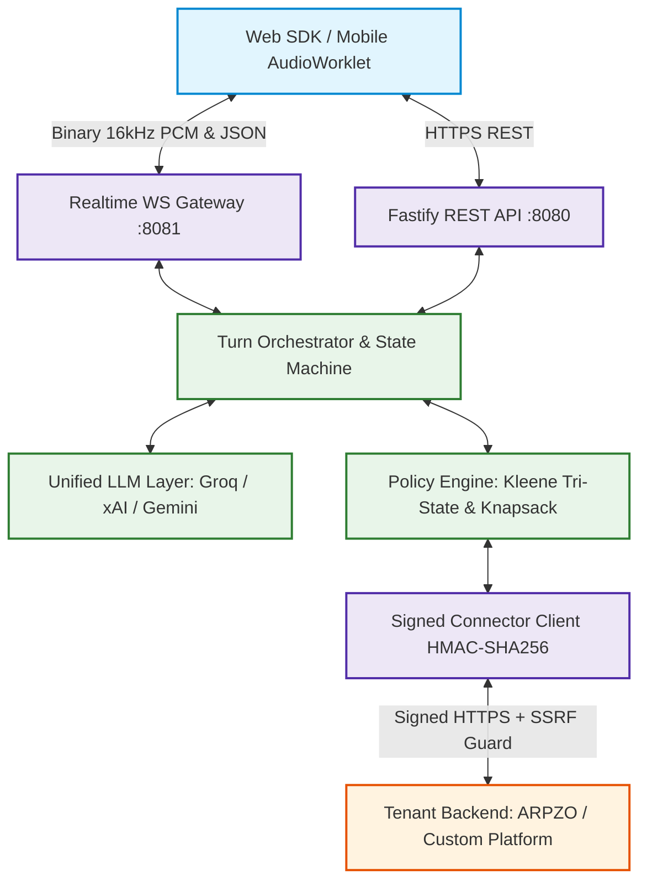

# Voice Commerce Assistant SaaS Platform

> **A Generic, Multi-Tenant, Multilingual Voice Commerce SaaS for Online Ordering Platforms**  
> Enables any commerce platform ("tenant") to plug in their own backend and database via a signed connector contract, allowing end customers to search menus, ask factual dietary questions, build carts, re-order, and track deliveries using natural voice or text in **English, Hindi, and Hinglish**.

[](https://github.com/vca/voice-commerce-assistant/actions)
[](LICENSE)
[](https://nodejs.org)
[](packages/eval)
[](docs/PERFORMANCE.md)

---

## 1. Architectural Highlights



1. **Ultra-Low Latency ($\le 3.0$s Voice Turn p95):**
   - Binary 16kHz linear PCM streaming over WebSocket.
   - Sentence/clause-boundary chunker triggers TTS streaming before full LLM completion.
   - Fast-path router achieves **sub-100ms LLM bypass** for confirmation, cancellation, and re-orders.
2. **100% Deterministic Commerce Truth:**
   - Kleene 3-valued logic (`TRUE`, `FALSE`, `UNKNOWN`): **Never** treats `UNKNOWN` as safe.
   - Zero hallucinated prices, taxes, or nutrition data: Grounding Guard strictly enforces tool catalog truth.
   - Combinatorial knapsack group budget solver executes in $< 50$ms.
3. **Pluggable Multi-Tenant Connector Contract:**
   - Any ordering platform integrates via signed HTTPS endpoints with HMAC-SHA256 and SSRF guard with RFC 1918 & cloud metadata IP pinning.
   - Certified with automated Conformance Test Kit.
4. **Unified Model Architecture (Single Point of Configuration):**
   - Switch between **Groq**, **xAI Grok**, **Google Gemini**, **OpenAI**, or **Mock** providers simply by changing `LLM_PROVIDER` and `LLM_MODEL` in `.env`.
5. **Multi-Tenant Isolation & Security:**
   - PostgreSQL Row-Level Security (RLS) enforcing tenant isolation at the database level.
   - Envelope encryption for sensitive fields with KMS master keys.
   - Transactional outbox metering, subscription spend caps, and automated circuit breaking at 100% monthly limit.
   - DPDP/GDPR compliance with automated 7-day retention cleaner.

---

## 2. Monorepo Workspaces

```text
voice-commerce-assistant/
├── apps/
│   ├── api/                  # REST Gateway (Sessions, Turns, Cart Confirm, Admin)
│   ├── realtime/             # Realtime WebSocket Voice Streaming Server (RFC 6455)
│   └── worker/               # Background Worker (Retention Cleaner, Metering Rollup)
├── packages/
│   ├── core/                 # Pure domain types, Money value object, Result monad, TenantContext
│   ├── platform/             # Config, KMS encryption, PII scrubber, concurrency, metering, observability
│   ├── connector-contract/   # OpenAPI 3.1 & TypeBox schemas for Tenant Connector API
│   ├── connector-sdk/        # Signed HTTPS client with SSRF guard and DNS pinning
│   ├── policy-engine/        # Kleene 3-valued tri-state logic, constraint evaluator, proposal manager
│   ├── policy-food/          # Food Domain Pack: Jain root veg rules, allergen safety, group budget solver
│   ├── llm/                  # Unified model factory (Groq, xAI Grok, Gemini, OpenAI), rate governor, prompt guard
│   ├── speech/               # Multilingual STT/TTS interfaces, sentence chunker, hosted adapters
│   ├── orchestrator/         # Conversation state machine, Hinglish normalizer, fast-path router, grounding guard
│   ├── web-sdk/              # Headless client SDK, 16kHz audio downsampler, interactive browser demo
│   └── eval/                 # 150 multilingual benchmark utterances, model bake-off, acceptance suite A01-A15
└── tools/
    └── demo-tenant/          # "ARPZO" Demo Tenant Backend with seeded Indian restaurant catalog
```

---

## 3. Quickstart Guide

### Prerequisites
- Node.js $\ge 24.0.0$ (native TypeScript stripping and test runner)
- Docker & Docker Compose (optional for PostgreSQL + Redis)

### Step 1: Clone and Configure Environment
```bash
git clone https://github.com/vca/voice-commerce-assistant.git
cd voice-commerce-assistant
cp .env.example .env
```

Edit `.env` to select your preferred LLM provider:
```ini
# Unified Model Switcher
LLM_PROVIDER=groq
LLM_MODEL=llama-3.3-70b-versatile
GROQ_API_KEY=your_groq_api_key_here

# To switch to xAI Grok:
# LLM_PROVIDER=xai
# LLM_MODEL=grok-2-1212
# XAI_API_KEY=your_xai_key_here

# To switch to Google Gemini:
# LLM_PROVIDER=gemini
# LLM_MODEL=gemini-1.5-flash
# GEMINI_API_KEY=your_gemini_key_here
```

### Step 2: Run Full Automated Test Suite
Run all 154 unit, integration, security, and acceptance tests in under 3 seconds:
```bash
node --experimental-strip-types --test (Get-ChildItem -Path packages,apps -Filter *.test.ts -Recurse | ForEach-Object { $_.FullName })
```

### Step 3: Run Interactive Browser Demo
1. Start the ARPZO Demo Tenant:
   ```bash
   node --experimental-strip-types tools/demo-tenant/src/index.ts
   ```
2. Start the REST and WebSocket Gateway servers:
   ```bash
   node --experimental-strip-types apps/api/src/index.ts
   node --experimental-strip-types apps/realtime/src/index.ts
   ```
3. Open `packages/web-sdk/src/demo/index.html` in your web browser.
   - Tap the microphone button or type queries like:
     - *"Ek cheese burst pizza add kar do"*
     - *"For 3 people, 2 veg and 1 non veg, under 1500"*
     - *"Kya paneer tikka Jain food hai?"*
     - *"Same as last time"*
     - *"Where is my order ord_live_77?"*

---

## 4. Acceptance Criteria Verification Matrix

All 15 core product requirements pass automated end-to-end acceptance tests:

| ID | Requirement | Status | Verification Evidence |
| :---: | :--- | :---: | :--- |
| **A01** | Voice & Text (EN, HI, Hinglish) | ✅ PASS | `packages/eval/src/acceptance/a01-a15.test.ts` (A01) |
| **A02** | Search & Factual Menu Questions | ✅ PASS | Grounding Guard verifies 100% price/calorie alignment |
| **A03** | Diet & Allergy Constraints | ✅ PASS | Tri-state logic rejects UNKNOWN claims |
| **A04** | Cart Assistance & Preview | ✅ PASS | Immutable 2-minute TTL proposals |
| **A05** | Group Ordering Mix & Budget | ✅ PASS | Combinatorial knapsack solver $\le 50$ms |
| **A06** | Preference Memory & Erasure | ✅ PASS | Explicit opt-in and right to erasure (`DELETE /v1/me/preferences`) |
| **A07** | Re-Order Completed Order | ✅ PASS | Maps past order, checks live price deltas, asks confirmation |
| **A08** | Live Order Tracking | ✅ PASS | Verifies customer ownership (`ord_live_77`) |
| **A09** | Pairing Suggestion | ✅ PASS | At most 1 dietary-compatible add-on per order |
| **A10** | Checkout Hand-Off | ✅ PASS | Pure handoff; assistant owns zero payment charge endpoints |
| **A11** | Sub-100ms LLM Fast-Path | ✅ PASS | Deterministic intent bypass completes in $< 10$ms |
| **A12** | Cross-Contact Safety | ✅ PASS | Blocks dishes when kitchen cross-contact risk is high |
| **A13** | Strict Jain Rules | ✅ PASS | Excludes potato, onion, garlic, carrot, radish |
| **A14** | Customer Ownership Check | ✅ PASS | Strictly throws ForbiddenError on foreign orders |
| **A15** | Token Cryptographic Defense | ✅ PASS | Rejects tampered and expired HMAC-SHA256 tokens |

---

## 5. Operations & Production Runbooks

- [Incident Response Runbook](docs/runbooks/INCIDENT_RESPONSE.md): Severity matrix, LLM 429 backoff, STT/TTS failover.
- [Disaster Recovery Runbook](docs/runbooks/DISASTER_RECOVERY.md): PostgreSQL PITR, emergency tenant revocation, DEK rotation.
- [Threat Model](docs/THREAT_MODEL.md): ASVS Level 2 STRIDE threat model across all trust boundaries.
- [Tenant Integration Guide](docs/INTEGRATION_GUIDE.md): Step-by-step connector implementation.
