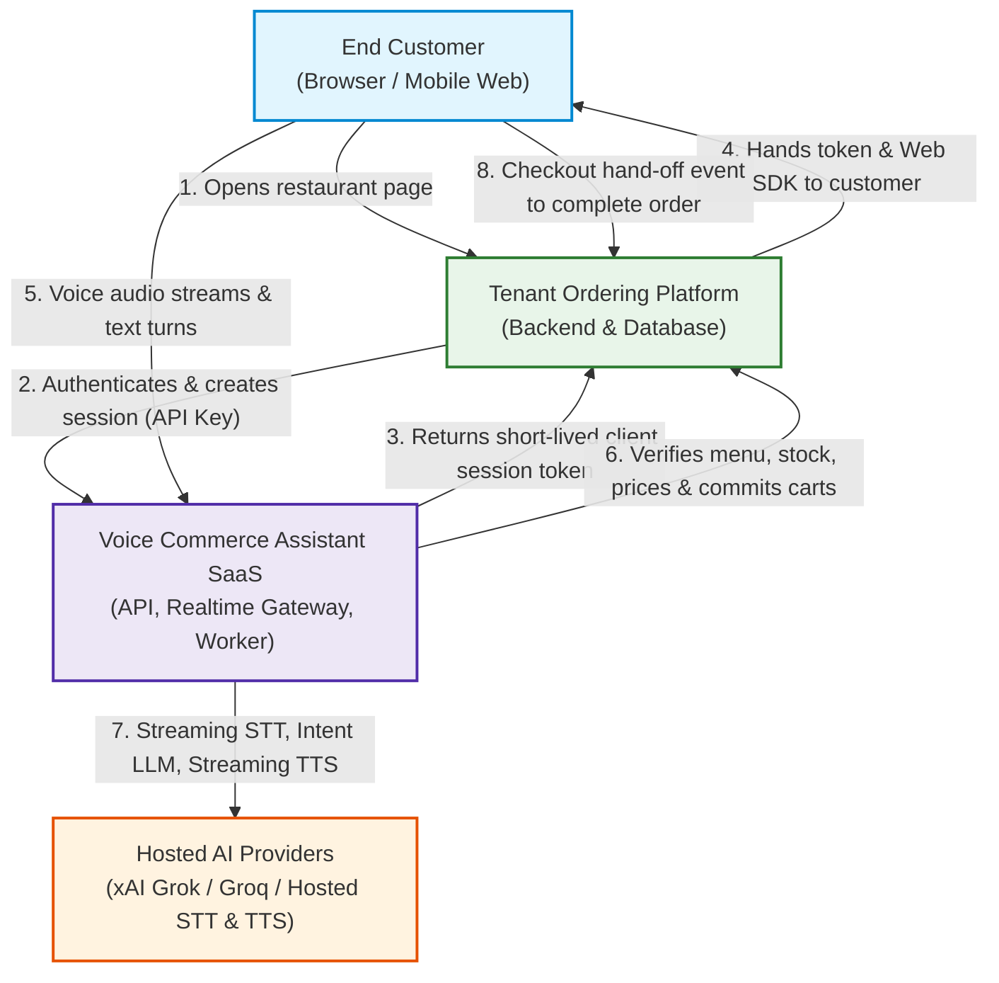
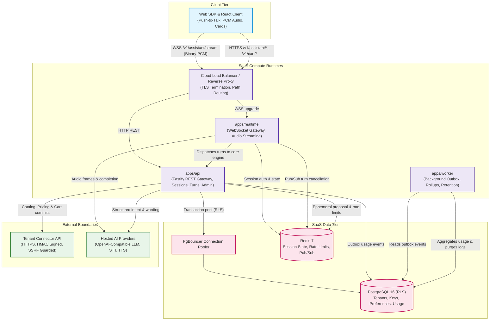
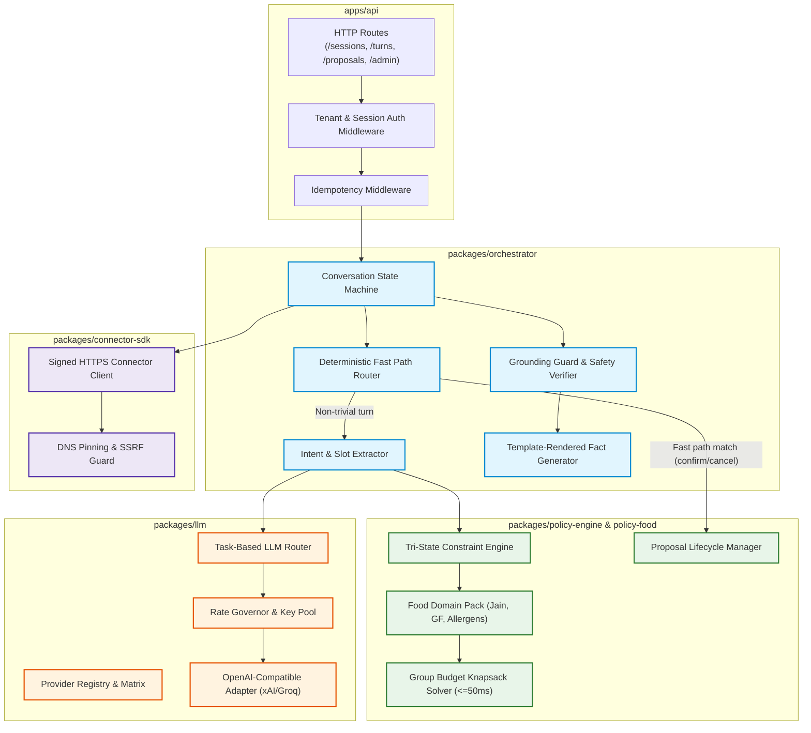
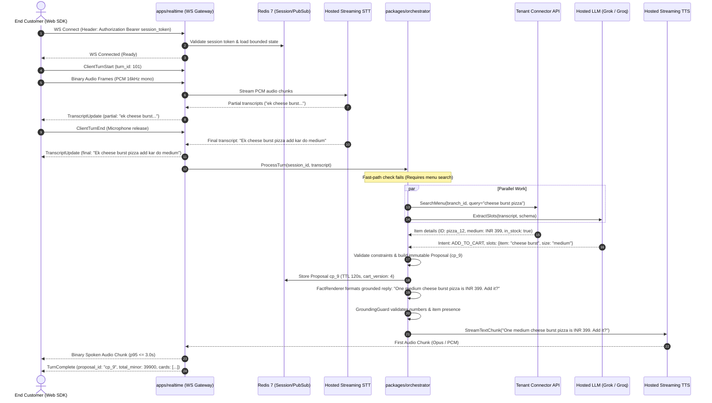
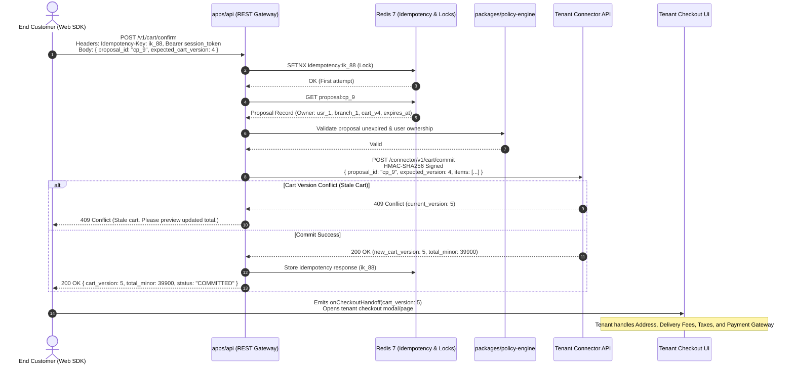
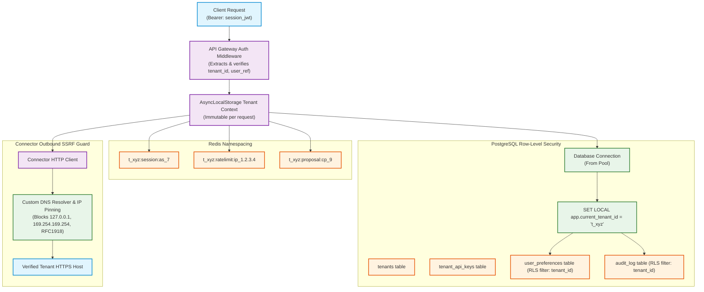
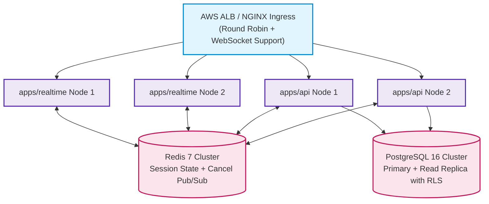

# System Architecture (ARCHITECTURE.md)

This document provides the formal architectural specification, C4 model diagrams, sequence workflows, security topologies, and scaling models for the Voice Commerce Assistant SaaS platform.

---

## 1. System Context (C4 Level 1)

The platform is a multi-tenant, hosted AI voice commerce engine. Tenants (online food ordering platforms) integrate the assistant into their customer-facing apps via our Web SDK and expose an HTTPS Connector API. The platform never connects directly to tenant databases and relies on deterministic policy engines for all commerce validation.

---

## 2. Container Diagram (C4 Level 2)

The system is deployed as a modular monolith with independently scalable runtimes.

---

## 3. Component Architecture (Inside `apps/api` and Core Packages)

---

## 4. Sequence Diagram: Voice Streaming & Turn Execution

This sequence details the push-to-talk voice interaction from audio frame capture to first spoken audio chunk.

---

## 5. Sequence Diagram: Cart Confirmation & Checkout Hand-Off

---

## 6. Multi-Tenant Isolation & Security Topology

---

## 7. Horizontal Scaling & Fault-Tolerant Topology

- **Stateless Gateway Nodes:** `apps/api` and `apps/realtime` hold no in-memory session truth. All conversational context is persisted in Redis with bounded TTLs. Any client can reconnect to any gateway node seamlessly.
- **Distributed Turn Cancellation:** When a user interrupts speech or re-connects, a Pub/Sub message (`session:{id}:cancel`) is published. All cluster nodes inspect active connections and cancel in-flight STT/LLM tasks immediately.
- **Bulkheads & Circuit Breakers:** Separate connection pools and concurrency limiters are maintained for LLM inference, STT/TTS providers, and Tenant Connector endpoints. A tenant connector failure never cascades into global platform instability.

