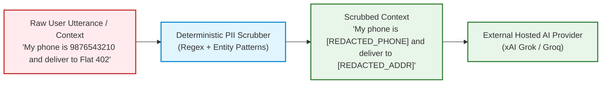
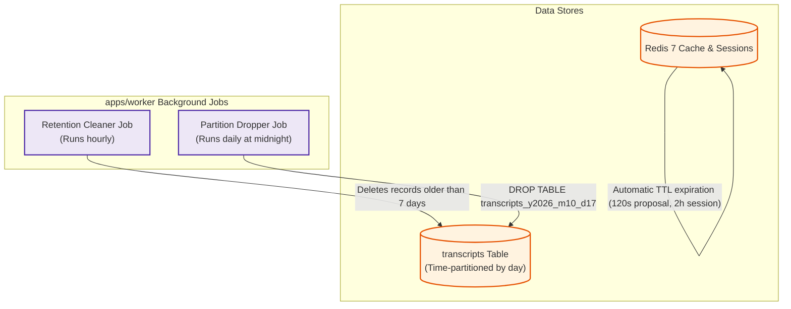

# Data Flows, PII Redaction & Cryptography (DATA_FLOWS.md)

This document maps all data lifecycles, classification levels, privacy safeguards, pre-provider redaction rules, and cryptographic boundaries across the Voice Commerce Assistant SaaS platform.

---

## 1. Data Classification Matrix

| Data Category | Classification | Examples | Storage Authority & Medium | Retention Period | Cross-Boundary Permitted? |
| :--- | :---: | :--- | :--- | :---: | :---: |
| **Catalog Metadata** | Public / Tenant | Dish names, descriptions, allergens, prices, stock | Tenant Platform (cached in Redis with menu version) | 15 min TTL / until invalidated | Yes (Sent to LLM for context) |
| **Tenant Secrets** | Highly Confidential | HMAC connector keys, tenant API keys, provider keys | PostgreSQL (Envelope Encrypted: AES-256-GCM) | Until rotated / revoked | **NEVER** leaves SaaS boundary |
| **User References** | Confidential | `user_ref` (opaque ID supplied by tenant backend) | Redis / PostgreSQL | Until session expiry | **NEVER** sent to AI providers |
| **Customer PII** | Restricted / PII | Phone numbers, delivery addresses, personal names | Tenant Backend (Passed only in opaque tracking metadata) | 0 days on SaaS (Redacted from logs) | **NEVER** sent to AI providers |
| **Audio Streams** | Ephemeral Audio | Binary PCM 16kHz audio chunks | Streamed directly through Gateway memory | **0 seconds** (Never saved to disk) | Streamed to hosted STT only |
| **Transcripts** | Confidential | User speech text & assistant generated replies | PostgreSQL (Time-partitioned) & Redis (Session) | **Strict 7 Days** (Auto-dropped) | Sent to LLM for current turn |
| **Cart Proposals** | Commercial | Proposal ID, item IDs, variant IDs, minor unit total | Redis (Ephemeral) | **2 Minutes** (Hard TTL) | Structure sent to client & tenant |
| **Customer Preferences**| Restricted | Consented veg/Jain/GF rules, allergen exclusions | PostgreSQL (Field-level encrypted) or Tenant Connector | Until edited or deleted | Sent to orchestrator / LLM |

---

## 2. Pre-Provider Redaction & Scrubbing Pipeline

Before any transcript, prompt, or tool output is dispatched to an external hosted AI provider (xAI, Groq, hosted STT/TTS), it passes through a deterministic PII Scrubber (`packages/platform/src/logging/pii-scrubber.ts`).



### Scrubbing Rules & Patterns
1. **Phone Numbers:** Indian and international phone numbers (10–12 digits, optional `+91`, separators) -> `[REDACTED_PHONE]`.
2. **Indian PIN Codes & Addresses:** 6-digit postal codes preceded by location markers, apartment/flat numbers -> `[REDACTED_ADDRESS]`.
3. **Authentication Tokens & Signatures:** JWT tokens, bearer tokens, HMAC hex strings, UUID session keys -> `[REDACTED_TOKEN]`.
4. **Email Addresses:** Standard RFC 5322 regex match -> `[REDACTED_EMAIL]`.
5. **Credit Card / Payment Markers:** 13–19 digit Luhn-passing numbers, CVVs, UPI IDs -> `[REDACTED_PAYMENT]`.

---

## 3. External AI Provider Data Handling & Privacy Audit

| Hosted Provider | Endpoint Protocol | Training on Customer Data | Data Retention Policy | Required Header / Opt-Out |
| :--- | :--- | :---: | :--- | :--- |
| **xAI (Grok API)** | HTTPS REST (`https://api.x.ai/v1`) | **No** (Enterprise API Terms) | Zero data retention for API inference | Standard developer API agreement |
| **GroqCloud** | HTTPS REST (`https://api.groq.com/openai/v1`) | **No** (Zero Data Retention on inference) | Does not persist prompt/completion payloads | Default API policy |
| **Hosted STT (Deepgram/Sarvam)** | WSS Streaming | **No** (When configured with `model: nova-2`, `no_store=true`) | Ephemeral audio frames discarded post-transcription | Query param: `?no_store=true` |
| **Hosted TTS (Cartesia/ElevenLabs)** | WSS Streaming | **No** | Ephemeral synthesis discarded post-generation | Zero-retention enterprise tier |

---

## 4. Cryptographic Architecture & Envelope Encryption

All persistent tenant secrets (connector signing keys, tenant-supplied API keys) and customer preferences are protected via envelope encryption:

```text
[Master Key / Cloud KMS]
       │
       ▼
 [Data Encryption Key (DEK)] ──(AES-256-GCM)──> [Encrypted DEK stored in DB]
       │
       ▼
 [Plaintext Data (Preferences / Secrets)]
       │
       ▼ (AES-256-GCM + Random IV + Auth Tag)
 [Encrypted Payload Stored in DB]
```

### Pluggable `KmsAdapter` Interface
- **Interface:** `encrypt(plaintext: Buffer): Promise<{ ciphertext: Buffer, encryptedDek: Buffer, iv: Buffer, tag: Buffer }>`
- **Local Dev Provider (`LocalDevKmsAdapter`):** Uses a local master key (`DEV_MASTER_ENCRYPTION_KEY`) in `.env`. Requires zero external cloud dependencies for local testing and CI.
- **Production Provider:** Plugs into AWS KMS, Google Cloud KMS, or HashiCorp Vault via the same interface without modifying domain code.

---

## 5. Storage Lifecycle, Deletion & DPDP/GDPR Compliance



### Customer Rights & Deletion Endpoints
- **Read Preferences:** `GET /v1/me/preferences` returns consented dietary rules and consent version.
- **Update Preferences:** `PATCH /v1/me/preferences` validates consent version and updates encrypted record.
- **Purge / Forget Me (DPDP / GDPR):** `DELETE /v1/me/preferences` permanently purges the stored preference row and invalidates associated session cache entries immediately.
- **Redaction in Logs:** Pino logger enforces redaction on keys: `["*.phone", "*.email", "*.address", "*.token", "*.authorization", "*.secret"]`.
