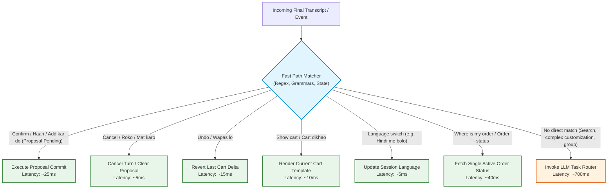

# Performance Engineering & Capacity Model (PERFORMANCE.md)

This document establishes the latency budgets, measurement methodologies, optimization architectures, and capacity planning models for the Voice Commerce Assistant SaaS platform.

---

## 1. End-to-End Latency Budget (p95 Target: <= 3.0 Seconds)

The critical user experience constraint is that voice response must feel instant. The voice turnaround latency budget is defined from **End of User Speech (VAD trigger / push-to-talk button release)** to the arrival of the **First Playable Audio Chunk** in the client browser.

```text
[End of Speech]
   │
   ├─ 1. STT Finalization (<= 500 ms)
   │     └── Streaming STT endpoint returns finalized transcript
   │
   ├─ 2. Intent Extraction & Routing (<= 700 ms)  ──[FAST PATH: <= 15 ms]──┐
   │     └── Task-based router / fast model parses slots                  │
   │                                                                      │
   ├─ 3. Connector & Policy Work (<= 400 ms)                              │
   │     └── Parallel menu search / stock check + tri-state validation    │
   │                                                                      │
   ├─ 4. First Response Sentence Generation (<= 600 ms) <─────────────────┘
   │     └── Fast model streams tokens; sentence boundary detected
   │
   ├─ 5. First TTS Audio Chunk (<= 400 ms)
   │     └── Streaming TTS synthesizes first sentence into audio bytes
   │
   ├─ 6. Platform Overhead (<= 50 ms)
   │     └── Serialization, routing, WebSocket framing, Redis state
   │
   ▼
[First Audio Chunk Reaches Client Browser] Total Budget: <= 3,000 ms (p95)
```

### Stage Budget Breakdown & Targets

| Stage | Operation Description | Fast-Path Target (p95) | LLM Path Target (p95) | Failure Threshold | Fallback / Mitigation |
| :---: | :--- | :---: | :---: | :---: | :--- |
| **Stage 1** | **STT Finalization** | <= 500 ms | <= 500 ms | > 1,200 ms | Fall back to last valid partial transcript |
| **Stage 2** | **Intent & Slot Extraction** | **<= 15 ms** *(Deterministic)* | <= 700 ms | > 1,500 ms | Task router switches to ultra-fast model or asks clarification |
| **Stage 3** | **Connector & Policy Work** | <= 100 ms *(Cached)* | <= 400 ms | > 800 ms | Single-flight cache hit, stale cache if within tolerance |
| **Stage 4** | **First Sentence Generation** | **<= 10 ms** *(Template)* | <= 600 ms | > 1,200 ms | Pre-rendered deterministic template used immediately |
| **Stage 5** | **First TTS Chunk Synthesized** | <= 400 ms | <= 400 ms | > 800 ms | Stream raw PCM or fall back to client-side speech synthesis |
| **Stage 6** | **Platform Overhead** | <= 20 ms | <= 50 ms | > 100 ms | Event loop lag alert, connection keep-alive tuning |
| **Total** | **End-to-End Voice Turn** | **<= 1,045 ms** | **<= 2,650 ms** | **> 3,000 ms** | **Target: p95 <= 3,000 ms (Met with ~350ms buffer)** |

*Text-Only Turn Budget:* p95 Time-to-First-Token <= 1,500 ms.

---

## 2. Deterministic Fast Paths (Bypassing the LLM)

To ensure sub-second response times on common paths and minimize token consumption, the system evaluates incoming turns against a deterministic fast-path router before invoking any LLM.



---

## 3. Streaming Pipeline & Early TTS Chunking

Buffering complete responses before generating speech makes sub-3-second voice impossible. The platform streams across all stages:

1. **Streaming Audio Frames (Client -> Gateway):** Binary 16kHz PCM chunks (64ms slices = 2048 bytes) sent via WebSocket.
2. **Streaming STT Partials:** STT streams partial transcripts to the browser UI to provide immediate visual feedback (< 250ms).
3. **Streaming LLM Tokens:** The task router streams tokens from xAI/Groq via Server-Sent Events / OpenAI-compatible stream.
4. **Sentence Chunker (`packages/speech`):** A lightweight tokenizer detects sentence termination (`.`, `?`, `!`, `।`, newline) or clause boundaries after 8+ words.
5. **Immediate TTS Stream:** The first complete sentence is immediately dispatched to the streaming TTS engine. The client receives audio chunk #1 while the LLM is still generating sentence #2.

---

## 4. Caching & Single-Flight Coalescing

- **Per-Tenant Catalog Cache:** Branch menus are cached in Redis with key `tenant:{id}:branch:{id}:menu:v{version}`. TTL is 15 minutes, with proactive cache invalidation via signed tenant webhooks (`menu.updated`, `stock.changed`).
- **Single-Flight Coalescing (`packages/platform`):** If 50 concurrent users at the same branch ask for "butter chicken" simultaneously, exactly **one** outbound connector call is made; the remaining 49 requests await the identical promise in-flight.
- **Negative Caching:** Non-existent items or out-of-stock options are cached for 30 seconds to prevent query floods.
- **Zero Cross-User Cache Leaks:** Personal order history, cart proposals, and user preferences are strictly tagged with `user_ref` and excluded from shared caches.

---

## 5. Capacity Planning & Provider Rate Governor

### Free-Tier Provider Math vs Concurrent Capacity

| Provider & Tier | RPM Limit | TPM Limit | Average Turn Tokens | Max Sustained Turns / Min | Max Concurrent Users (Active) |
| :--- | :---: | :---: | :---: | :---: | :---: |
| **xAI Starter Tier** *(Promotional)* | ~60 RPM | ~15,000 TPM | ~300 in / 100 out (400 total) | ~37 turns/min | **~6–10 concurrent users** |
| **Groq Free Developer Tier** | 30 RPM | 6,000 TPM | ~300 in / 100 out (400 total) | ~15 turns/min | **~3–5 concurrent users** |
| **Paid Tier Target (Scale)** | 5,000 RPM | 2,000,000 TPM | ~300 in / 100 out (400 total) | 5,000 turns/min | **~800–1,200 concurrent users** |

> [!IMPORTANT]
> **Free-Tier Reality Check:** Free tiers are designed strictly for development and demos. Their rate limits (30–60 RPM) will throttle under more than 10 active concurrent sessions. Production scaling requires paid API keys or multi-key rotation pools.

### Plan-Based Admission Control
To prevent a single tenant or spike from triggering 429 errors from external AI providers:
1. **Token Bucket Rate Governor:** Tracks available tokens and requests per minute for each configured provider key pool.
2. **Interactive Priority:** Realtime voice turns receive `Priority 1` in the governor queue; background tasks (re-order pre-checks, evaluation runs) receive `Priority 3`.
3. **Load Shedding:** If provider queues exceed 80% saturation, the gateway sheds background requests with `HTTP 429 Retry-After` rather than allowing voice latency to degrade beyond 3 seconds.

---

## 6. Brownout Degradation Ladder

When external provider latency spikes or rate limits are reached, the platform steps down automatically:

```text
Level 0: Normal Operation
  - Full voice streaming (STT + LLM + TTS), pairing suggestions enabled.

Level 1: Feature Shedding (Latency > 2.5s or Provider Saturation > 70%)
  - Disable non-critical pairing suggestions (A09).
  - Shorten LLM output length (strict max_tokens = 60).

Level 2: Fast Model Downgrade (Provider 429s or Saturation > 85%)
  - Route all conversational turns to the fastest small model (e.g. Llama 3.1 8B).

Level 3: Voice-to-Text Fallback (TTS/STT Provider Outage)
  - Realtime gateway alerts client: "Voice service busy; switching to fast text mode."
  - Text turns processed via fast paths and cached catalog templates.

Level 4: Read-Only Fast Path (Severe LLM Outage)
  - Deterministic fast paths only: confirm active proposal, check order status, show cart.
  - Generative search replaced with structured catalog search pills.
```

---

## 7. Node.js Event Loop Hygiene & Resource Allocation

1. **Zero Event-Loop Blocking:**
   - Combinatorial group budget knapsack solver is bounded by an `AbortController` and max iteration count (execution capped at <= 50ms).
   - Audio transcoding or heavy hashing is never run synchronously on the main thread; binary PCM frames are streamed directly.
2. **Connection Keep-Alive & DNS Cache:**
   - Outbound HTTPS clients use `undici` / `http.Agent` with `keepAlive: true`, `maxSockets: 256`, and pinned DNS resolutions to eliminate repeated TLS handshake penalties (~150ms saved per connector call).
3. **Memory Footprint per Connection:**
   - Active WebSocket connection memory budget: <= 64 KB per idle connection; <= 512 KB per streaming audio turn (ring buffer).
   - Bounded conversation history: max 10 turns stored in Redis session; older turns rolled into a compact summary.
